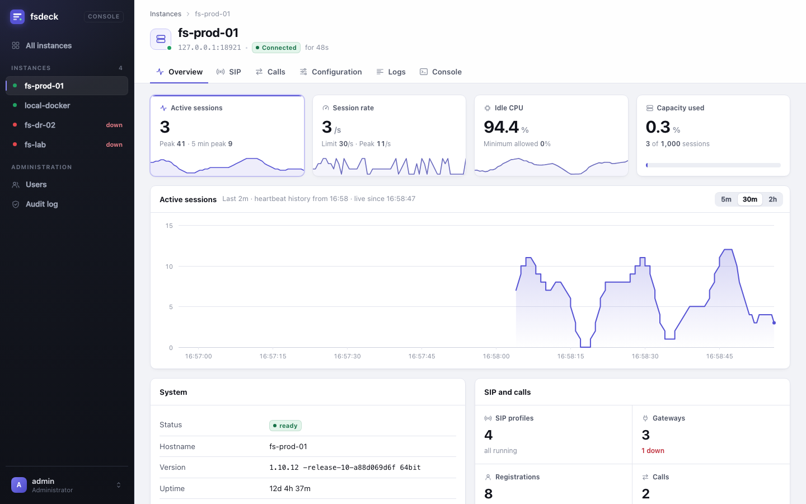
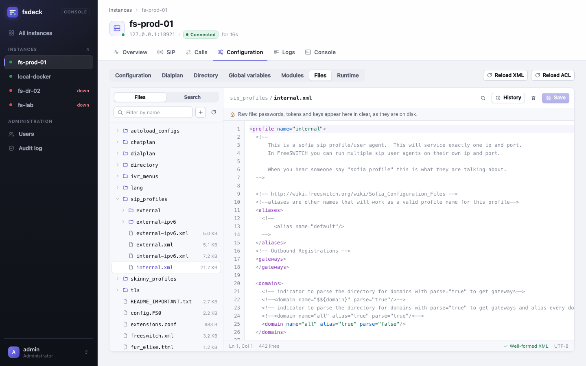
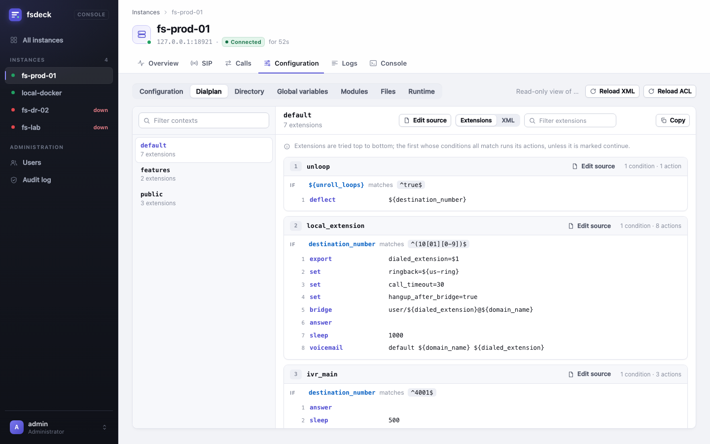
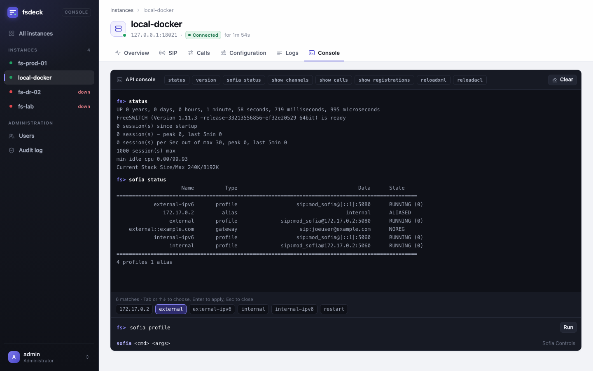
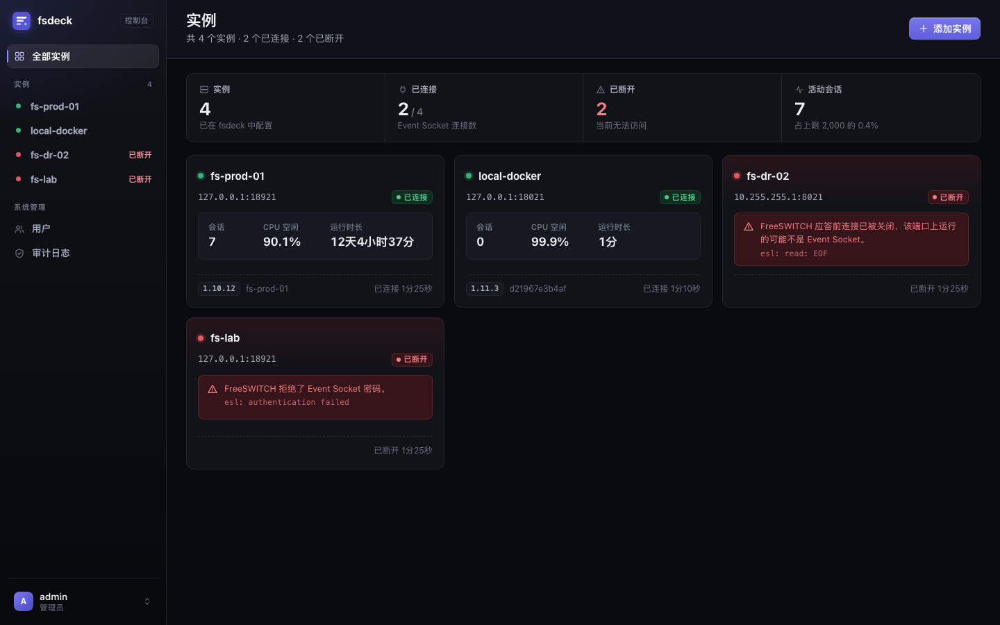

# fsdeck

**A web console for operating FreeSWITCH.** Point it at the Event Socket of any
running FreeSWITCH and see what the switch is doing, change what it does, and
keep a record of who changed what.

English | [简体中文](README.zh-CN.md)



- **Nothing to install on FreeSWITCH.** fsdeck connects to `mod_event_socket`,
  which the stock configuration already loads.
- **It does not take over your configuration.** There is no database schema and
  no XML generator. fsdeck shows what FreeSWITCH has loaded; when you edit a
  file, it is your file, with the previous version kept.
- **One binary.** Go standard library only, the web interface is embedded, no
  build step for the frontend.
- **Many switches, one console**, in English and Simplified Chinese.

## What you get

| Area | What it does | Behind it |
|---|---|---|
| Instances | one card per FreeSWITCH: connection, sessions, idle CPU, uptime, version; a plain-language reason when a switch cannot be reached | `json status` |
| Overview | sessions, session rate, idle CPU and capacity over the last two hours, SIP and call summary | `json status`, `HEARTBEAT` events |
| SIP | profiles, gateways, aliases, registrations; start, stop, restart and rescan profiles; register, unregister and remove gateways | `sofia xmlstatus`, `sofia profile …` |
| Calls | channels and bridged calls with live durations, every field in a side panel, hang up | `show channels`, `show calls`, `uuid_kill` |
| Configuration | the effective configuration as FreeSWITCH parsed it, global variables, modules (load, unload, reload) | `xml_locate`, `global_getvar`, `show modules` |
| Dialplan | contexts and extensions read as "if this matches, run these actions", or as XML | `xml_locate dialplan` |
| Directory | domains with a users table: groups, caller id, context, whether a password is set | `xml_locate directory` |
| Config files | file tree and XML editor, search across files, a diff to review before saving, history and restore, apply actions that show FreeSWITCH's answer | files on the host, directly or through `fsdeck-agent` |
| Runtime settings | log level, session limits, pause and resume, global variables, each confirmed and marked as lasting until restart | `fsctl`, `global_setvar` |
| Logs | live tail with the recent backlog, level, severity and text filters | `log <level>` |
| Console | any API command, with Tab completion and syntax hints like `fs_cli` | `api <command>`, `console_complete_xml` |
| Accounts and audit | administrator, operator and read-only roles; a searchable record of every sign-in and change | |

The read-only views lead to the source: from a configuration, a dialplan
extension, a directory user or a global variable, "Edit source" opens the file
that defines it at the right line.

Passwords, DSNs and similar values are masked in the configuration, dialplan,
directory and variable views, including secrets assigned inside a value such
as `sip_auth_password=…` in a dial string.

| | |
|---|---|
|  |  |
|  |  |

## Quick start

```sh
go install github.com/juki/fsdeck/cmd/fsdeck@latest
FSDECK_ADMIN_PASSWORD='choose-a-long-one' fsdeck
```

or from a checkout:

```sh
go build -o fsdeck ./cmd/fsdeck
FSDECK_ADMIN_PASSWORD='choose-a-long-one' ./fsdeck
```

Open <http://127.0.0.1:8080>, sign in as `admin`, add an instance (host, Event
Socket port, Event Socket password). Without `FSDECK_ADMIN_PASSWORD` the first
start creates `admin` with a random password and prints it once.

With Docker:

```sh
docker build -t fsdeck .
docker run --rm -p 127.0.0.1:8080:8080 -v fsdeck-data:/data \
  -e FSDECK_ADMIN_PASSWORD='choose-a-long-one' fsdeck
```

## Connecting FreeSWITCH

fsdeck connects to `mod_event_socket` (default port 8021). Out of the box
FreeSWITCH only accepts Event Socket connections from the local host and uses
the well-known password `ClueCon`. To reach it from another host, edit
`autoload_configs/event_socket.conf.xml`:

```xml
<configuration name="event_socket.conf" description="Socket Client">
  <settings>
    <param name="listen-ip" value="0.0.0.0"/>
    <param name="listen-port" value="8021"/>
    <param name="password" value="a-long-random-password"/>
    <param name="apply-inbound-acl" value="fsdeck"/>
  </settings>
</configuration>
```

and allow the fsdeck host in `autoload_configs/acl.conf.xml`:

```xml
<list name="fsdeck" default="deny">
  <node type="allow" cidr="192.0.2.10/32"/>
</list>
```

Then `reloadacl` and `reload mod_event_socket`. Change the default password
before the port is reachable from anywhere else: the Event Socket gives full
control of the switch. An SSH tunnel to `127.0.0.1:8021` works without any of
these changes.

## Editing configuration

An administrator can browse, search, edit, delete and restore the
configuration files of an instance. The Event Socket has no file access, so
fsdeck needs one of two ways to reach the files; choose it when adding or
editing the instance.

- **On this server.** fsdeck runs on the FreeSWITCH host (or shares its conf
  directory); give it the path, for example `/etc/freeswitch`. The fsdeck user
  needs write access.
- **Through an agent.** Run `fsdeck-agent` on the FreeSWITCH host and give
  fsdeck its URL and token:

  ```sh
  go install github.com/juki/fsdeck/cmd/fsdeck-agent@latest
  head -c 32 /dev/urandom | base64 > /etc/fsdeck-agent.token
  chmod 600 /etc/fsdeck-agent.token
  fsdeck-agent -root /etc/freeswitch -backups /var/lib/fsdeck-agent/backups \
    -token-file /etc/fsdeck-agent.token -listen 0.0.0.0:8025 \
    -tls-cert agent.pem -tls-key agent.key
  ```

  Without `-tls-cert` the token and the files cross the network in clear; keep
  the agent on `127.0.0.1` and use an SSH tunnel then.

What a save does: it checks the XML is well-formed, checks nobody changed the
file since you opened it, keeps the previous version (the last 50 per file,
outside the conf directory), then writes atomically. Saving does not apply
anything: the page then offers the actions that fit the file (Reload XML, a
profile rescan, Reload ACL, a module reload) and shows FreeSWITCH's answer. If
the answer is an error, one click restores the previous version.

Limits: `.xml .lua .conf .tpl .txt .json .cfg .ini` files up to 1 MiB of UTF-8
text, nothing outside the conf directory, also not through a symbolic link.
Configuration served by `mod_xml_curl` or a database is not in files and has
to be changed at its source. Changes to a profile's ports, addresses or TLS
need a profile restart, which drops its calls; fsdeck says so and asks first.

## Accounts

| | Read only | Operator | Administrator |
|---|---|---|---|
| Status, SIP, calls, configuration, dialplan, directory (masked), load history | yes | yes | yes |
| Logs | no | yes | yes |
| Hang up, Reload XML, Reload ACL, profile rescan, gateway register and unregister | no | yes | yes |
| Profile start, stop, restart; remove gateways; modules; runtime settings | no | no | yes |
| Console | no | no | yes |
| Manage instances and accounts, read the audit log, edit config files | no | no | yes |

Accounts live in the data file. Passwords are 10 to 256 characters, stored as
PBKDF2-SHA256 hashes. Changing an account's role or password, disabling or
deleting it signs it out everywhere. Nobody can delete, disable or demote the
account they are signed in with, and the last enabled administrator stays.

`FSDECK_ADMIN_PASSWORD` and `FSDECK_VIEWER_PASSWORD` keep the accounts `admin`
and `viewer` with that password, whatever the data file says. The console
shows them as managed by the environment and cannot change them.

## Configuration

| Flag | Environment | Default | Purpose |
|---|---|---|---|
| `-listen` | `FSDECK_LISTEN` | `127.0.0.1:8080` | listen address |
| `-data` | `FSDECK_DATA` | `fsdeck.json` | data file: instances with their Event Socket passwords and agent tokens, and accounts (mode 0600) |
| `-audit` | `FSDECK_AUDIT` | `fsdeck-audit.log` beside the data file | audit log; an empty value disables it |
| `-log-backlog` | `FSDECK_LOG_BACKLOG` | `2000` | log lines kept per instance and replayed when the Logs view opens; `0` disables |
| `-log-backlog-level` | `FSDECK_LOG_BACKLOG_LEVEL` | `6` (INFO) | highest log level kept in the backlog, `0` to `7` |
| `-tls-cert`, `-tls-key` | `FSDECK_TLS_CERT`, `FSDECK_TLS_KEY` | unset | serve HTTPS with this PEM certificate and key; both or neither |
| | `FSDECK_SECRET_KEY` | unset | encrypt the Event Socket passwords and agent tokens in the data file; at least 16 characters |
| | `FSDECK_ADMIN_PASSWORD` | unset | password of the managed `admin` account |
| | `FSDECK_VIEWER_PASSWORD` | unset | password of the managed `viewer` account |
| `-static` | | unset | serve the frontend from this directory instead of the embedded copy (development) |
| `-version` | | | print the version and exit |

With a backlog, fsdeck keeps the log level of every instance's Event Socket
connection at least at `-log-backlog-level`, so FreeSWITCH sends INFO lines
even while nobody watches the Logs view. `GET /healthz` answers
`{"status":"ok"}` without signing in, for load balancers and container health
checks. The load history is kept in memory, one sample per FreeSWITCH
heartbeat (every 20 seconds by default).

## Security notes

- An administrator can run any FreeSWITCH API command and edit its
  configuration. Treat the role like shell access to the switch.
- Without `-tls-cert` and `-tls-key` fsdeck serves plain HTTP. Keep it on a
  trusted network or behind a TLS-terminating reverse proxy that sets
  `X-Forwarded-Proto: https`, so the session cookie is marked `Secure`.
- Event Socket passwords and agent tokens are stored in clear in the data file
  unless `FSDECK_SECRET_KEY` is set; with it they are encrypted with
  AES-256-GCM. fsdeck refuses to start when the file holds encrypted values
  and the key is missing or wrong. Protect the data file either way: it also
  holds the password hashes.
- Five failed sign-ins for an account from one address within five minutes
  block that pair for a minute. Behind a reverse proxy every client shares the
  proxy's address, so the block then applies to the account as a whole.
- The audit log records sign-ins (also failed and blocked ones), sign-outs,
  instance and account changes, hang-ups, runtime operations, config file
  changes (path and hashes, not the content), refused requests and every
  console command in full. It never records passwords, tokens or session
  cookies, but console commands can carry secrets: the file has mode 0600 and
  only administrators can read it in the console.
- Config files are shown and edited as they are, secrets included, and log
  lines are not masked; that is why both are limited to the roles above.

## Trying it against a stock FreeSWITCH in Docker

Vanilla FreeSWITCH needs three changes to be reachable from the Docker host:
listen on IPv4, an ACL that allows the host, and no STUN lookup (it fails
without outbound UDP and keeps `mod_sofia` from loading).

```sh
docker run -d --name dev-fsdeck-freeswitch -p 127.0.0.1:18021:8021 \
  --entrypoint sh safarov/freeswitch:1.11.3 -c '
set -e
C=/etc/freeswitch
mkdir -p $C && cp -a /usr/share/freeswitch/conf/vanilla/. $C/
sed -i -e "s|name=\"listen-ip\" value=\"::\"|name=\"listen-ip\" value=\"0.0.0.0\"|" \
  -e "s|<!--<param name=\"apply-inbound-acl\" value=\"loopback.auto\"/>-->|<param name=\"apply-inbound-acl\" value=\"fsdeck\"/>|" \
  $C/autoload_configs/event_socket.conf.xml
sed -i -e "s|<network-lists>|<network-lists>\n<list name=\"fsdeck\" default=\"deny\">\n<node type=\"allow\" cidr=\"127.0.0.0/8\"/>\n<node type=\"allow\" cidr=\"10.0.0.0/8\"/>\n<node type=\"allow\" cidr=\"172.16.0.0/12\"/>\n<node type=\"allow\" cidr=\"192.168.0.0/16\"/>\n</list>|" \
  $C/autoload_configs/acl.conf.xml
sed -i -e "s|cmd=\"stun-set\" data=\"external_rtp_ip=stun:stun.freeswitch.org\"|cmd=\"set\" data=\"external_rtp_ip=\$\${local_ip_v4}\"|" \
  -e "s|cmd=\"stun-set\" data=\"external_sip_ip=stun:stun.freeswitch.org\"|cmd=\"set\" data=\"external_sip_ip=\$\${local_ip_v4}\"|" \
  -e "s|default_password=1234|default_password=$(tr -dc A-Za-z0-9 < /dev/urandom | head -c 20)|" $C/vars.xml
exec /usr/bin/freeswitch -nc -nf -nonat'
```

Add it in fsdeck as host `127.0.0.1`, port `18021`, password `ClueCon`. For
some traffic to look at:

```sh
docker exec dev-fsdeck-freeswitch fs_cli -x 'bgapi originate loopback/9196/default &park()'
```

The image is amd64 only; on Apple silicon add `--platform linux/amd64`. To try
the file editor as well, mount a host directory at `/etc/freeswitch` and give
fsdeck that path.

## Not in scope

- Call history and SIP capture. Homer and CDR tools cover those.
- Long-term metrics. Prometheus and Grafana cover those.
- Generating configuration. fsdeck edits the files you have.

## Development

```sh
go vet ./... && go test -race ./...
./fsdeck -static web/static     # serve the frontend from disk while working on it
```

No third-party Go modules and no frontend build step: `web/static` is plain
ES modules, served as is. Interface text lives in
`web/static/js/locales/`; a test keeps the languages in step.

## License

GNU Affero General Public License, version 3 (`LICENSE`).

FreeSWITCH is a trademark of its owner; fsdeck is an independent project and
is not affiliated with or endorsed by the FreeSWITCH project or SignalWire.
