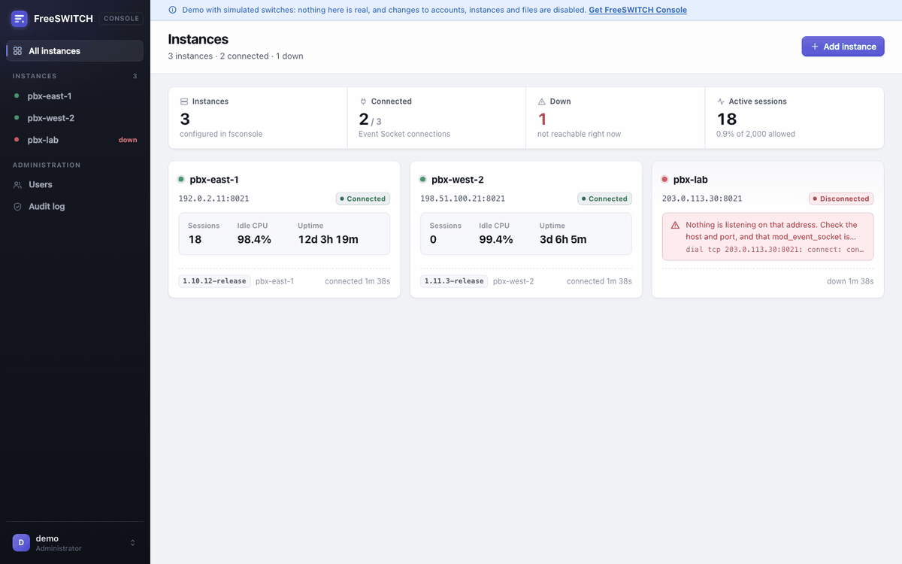
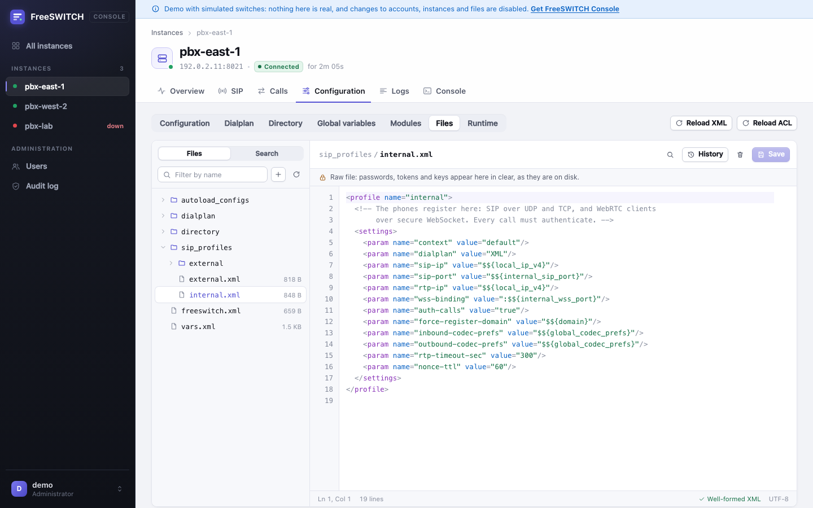
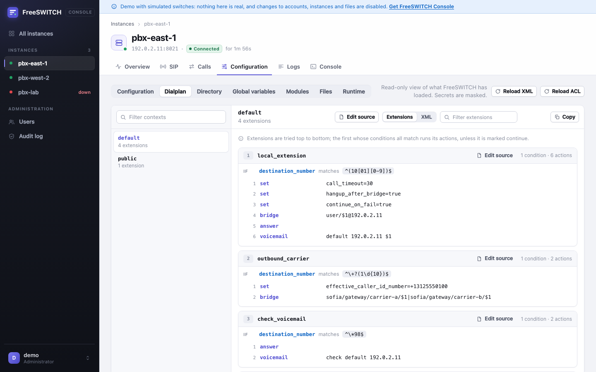
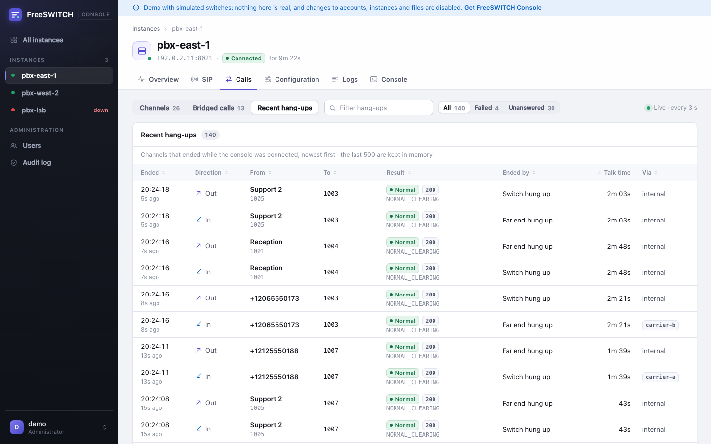
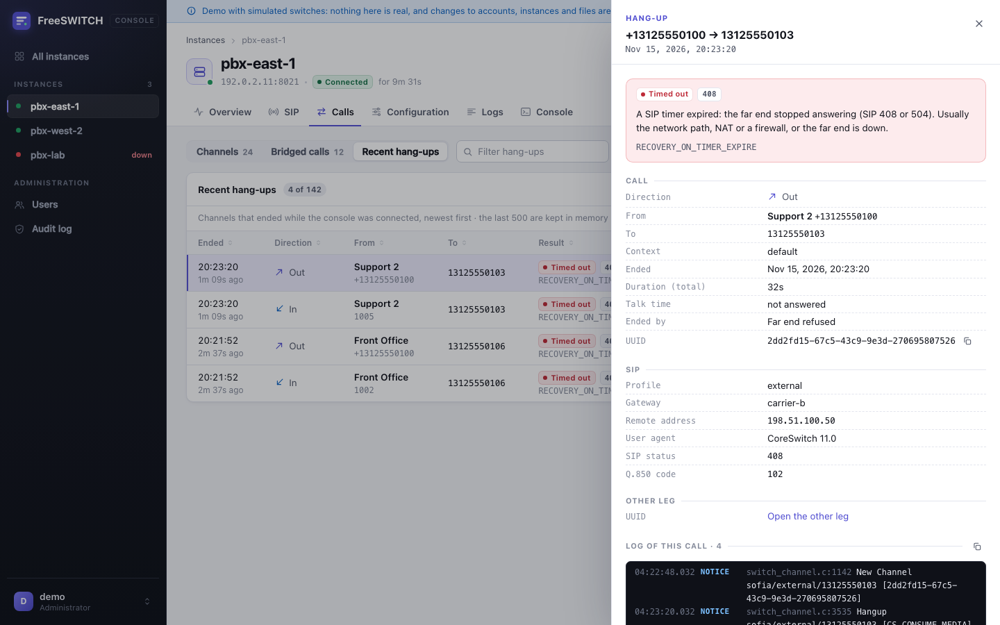
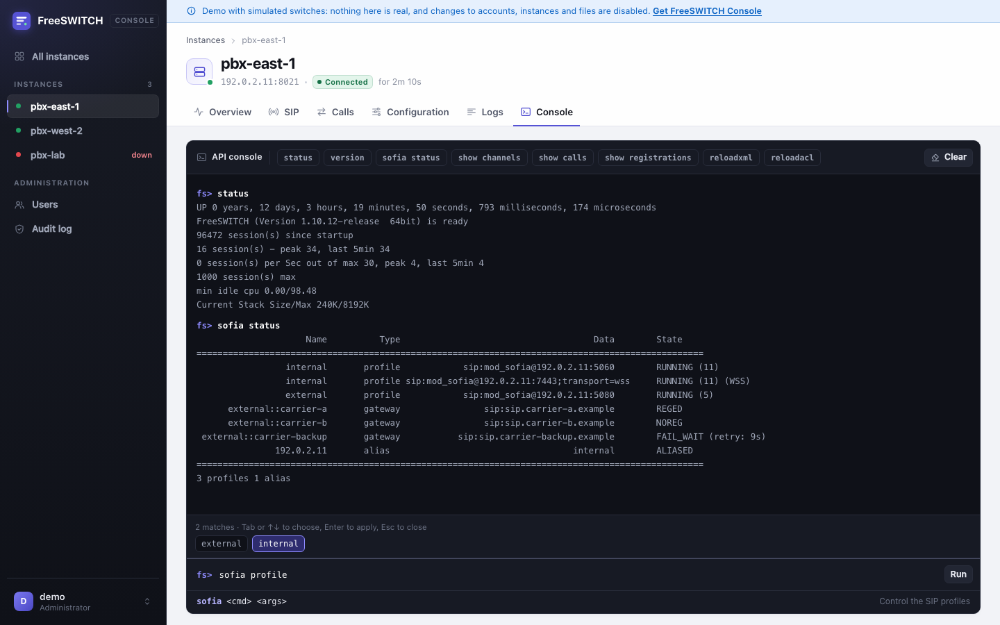
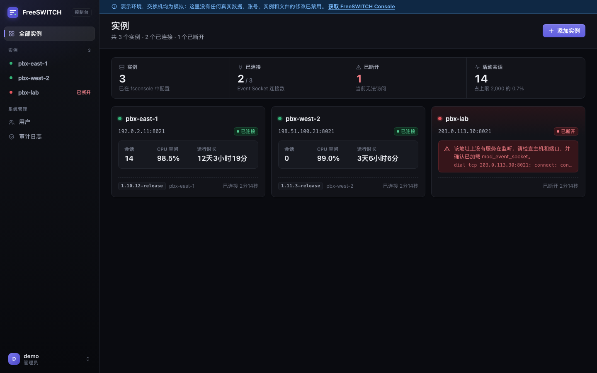

# FreeSWITCH Console

**FreeSWITCH 的 Web 运维控制台。** 把 `fsconsole` 指向任意一台正在运行的 FreeSWITCH 的 Event Socket，就能看到交换机在做什么、改变它的行为，并留下“谁改了什么”的记录。这是一个独立的开源项目，与 FreeSWITCH 项目及 SignalWire 没有隶属关系。

[English](README.md) | 简体中文



- **FreeSWITCH 一侧零安装。** fsconsole 连接的是 `mod_event_socket`，原版配置默认就加载了它。
- **不接管你的配置。** 没有数据库表结构，也不生成 XML。fsconsole 展示的是 FreeSWITCH 实际加载的内容；你编辑的就是你自己的文件，旧版本会被保留。
- **单个二进制。** 只用 Go 标准库，Web 界面内嵌其中，前端没有构建步骤。
- **一个控制台管多台交换机**，界面支持简体中文和英文。

**没有 FreeSWITCH 也能先试。** 演示模式会启动三台模拟交换机，有通话、注册、日志和挂断记录；不保存任何数据，也不连接任何真实系统：

```sh
docker run --rm -p 127.0.0.1:8080:8080 ghcr.io/juki/freeswitch-console -demo
```

## 功能

| 模块 | 能做什么 | 背后用到的 |
|---|---|---|
| 实例 | 每台 FreeSWITCH 一张卡片：连接状态、会话数、CPU 空闲、运行时长、版本；连不上时用大白话说明原因 | `json status` |
| 概览 | 最近两小时的会话数、会话速率、CPU 空闲和容量占用，SIP 与通话速览 | `json status`、`HEARTBEAT` 事件 |
| SIP | Profile、网关、别名、注册；启动、停止、重启、重扫 Profile；网关注册、注销、移除；开关某个 Profile 的 SIP 跟踪 | `sofia xmlstatus`、`sofia profile …` |
| 通话 | 通道和桥接通话，实时时长，侧边栏查看全部字段，挂断 | `show channels`、`show calls`、`uuid_kill` |
| 最近挂断 | 不装 CDR 模块也能看出一通电话为什么结束：最近 500 个挂断的通道，用大白话解释挂断原因，并给出 SIP 状态码、谁挂的、通话时长、MOS、这通电话自己的日志行和全部变量 | `CHANNEL_HANGUP_COMPLETE` 事件 |
| 配置 | FreeSWITCH 解析后的生效配置、全局变量、模块（加载、卸载、重载） | `xml_locate`、`global_getvar`、`show modules` |
| 拨号计划 | 按“如果匹配，则依次执行”的方式阅读各 context 和分机，也可看 XML | `xml_locate dialplan` |
| 用户目录 | 各域的用户表：分组、主叫显示、上下文、是否设置了密码 | `xml_locate directory` |
| 配置文件 | 文件树和 XML 编辑器、跨文件搜索、保存前差异确认、历史与回滚、生效操作并显示 FreeSWITCH 的应答 | 主机上的文件，直接访问或经 `fsconsole-agent` |
| 运行参数 | 日志级别、会话上限、暂停与恢复、全局变量；每项都需确认，并注明重启后失效 | `fsctl`、`global_setvar` |
| 日志 | 实时日志并回放最近的内容，可按级别、严重程度、文本筛选 | `log <level>` |
| 控制台 | 任意 API 命令，像 `fs_cli` 一样支持 Tab 补全和语法提示；命令在后台执行，慢命令不会拖住控制台的其他操作 | `bgapi <command>`、`console_complete_xml` |
| 账号与审计 | 管理员、操作员、只读三种角色；每次登录和变更都可检索 | |

只读页面可以直达源文件：在配置项、拨号计划的分机、目录里的用户或全局变量上点“编辑源文件”，会打开定义它的那个文件并定位到对应行。

配置、拨号计划、用户目录和变量页面里的密码、DSN 等敏感值都会被隐藏，包括写在值里面的密码（例如拨号串里的 `sip_auth_password=…`）。

| | |
|---|---|
|  |  |
|  |  |
|  |  |

## 快速开始

使用 Docker（linux/amd64 和 linux/arm64）：

```sh
docker run --rm -p 127.0.0.1:8080:8080 -v fsconsole-data:/data \
  -e FSCONSOLE_ADMIN_PASSWORD='设一个足够长的密码' ghcr.io/juki/freeswitch-console
```

或者从 [Releases](https://github.com/juki/freeswitch-console/releases) 下载对应平台的压缩包（Linux、macOS、Windows；每个包里有 `fsconsole` 和 `fsconsole-agent`，可用 `checksums.txt` 校验），然后运行：

```sh
FSCONSOLE_ADMIN_PASSWORD='设一个足够长的密码' ./fsconsole
```

也可以用 Go 安装：`go install github.com/juki/freeswitch-console/cmd/fsconsole@latest`，或在源码目录里 `go build -o fsconsole ./cmd/fsconsole`。

打开 <http://127.0.0.1:8080>，用 `admin` 登录，添加一个实例（主机、Event Socket 端口、Event Socket 密码）。如果没有设置 `FSCONSOLE_ADMIN_PASSWORD`，首次启动会创建 `admin` 账号并打印一次随机密码。

在容器里，控制台监听所有网卡，数据保存在 `/data`；除非前面有负责 TLS 的反向代理，否则请只把端口发布到 `127.0.0.1`。自己构建镜像：`docker build -t fsconsole .`

## 连接 FreeSWITCH

fsconsole 连接 `mod_event_socket`（默认端口 8021）。原版 FreeSWITCH 只接受本机的 Event Socket 连接，并使用众所周知的默认密码 `ClueCon`。要从其他主机连接，修改 `autoload_configs/event_socket.conf.xml`：

```xml
<configuration name="event_socket.conf" description="Socket Client">
  <settings>
    <param name="listen-ip" value="0.0.0.0"/>
    <param name="listen-port" value="8021"/>
    <param name="password" value="一个足够长的随机密码"/>
    <param name="apply-inbound-acl" value="fsconsole"/>
  </settings>
</configuration>
```

并在 `autoload_configs/acl.conf.xml` 里放行 fsconsole 所在主机：

```xml
<list name="fsconsole" default="deny">
  <node type="allow" cidr="192.0.2.10/32"/>
</list>
```

然后执行 `reloadacl` 和 `reload mod_event_socket`。在端口对外可达之前务必改掉默认密码：Event Socket 拥有对交换机的完全控制权。如果不想改这些配置，用 SSH 隧道连到 `127.0.0.1:8021` 也可以。

## 编辑配置

管理员可以浏览、搜索、编辑、删除和恢复实例的配置文件。Event Socket 本身不能读写文件，所以 fsconsole 需要下面两种方式之一来访问文件，在添加或编辑实例时选择。

- **在本服务器上。** fsconsole 与 FreeSWITCH 在同一台主机（或共享配置目录），填写配置目录路径即可，例如 `/etc/freeswitch`。运行 fsconsole 的用户需要有写权限。
- **通过代理。** 在 FreeSWITCH 主机上运行 `fsconsole-agent`，把它的地址和令牌填给 fsconsole：

  ```sh
  go install github.com/juki/freeswitch-console/cmd/fsconsole-agent@latest
  head -c 32 /dev/urandom | base64 > /etc/fsconsole-agent.token
  chmod 600 /etc/fsconsole-agent.token
  fsconsole-agent -root /etc/freeswitch -backups /var/lib/fsconsole-agent/backups \
    -token-file /etc/fsconsole-agent.token -listen 0.0.0.0:8025 \
    -tls-cert agent.pem -tls-key agent.key
  ```

  不加 `-tls-cert` 时，令牌和文件内容会以明文在网络上传输；这种情况下请让代理只监听 `127.0.0.1`，并通过 SSH 隧道访问。

一次保存会做这些事：检查 XML 格式是否完整；检查文件在你打开之后有没有被别人改过；保留旧版本（每个文件保留最近 50 版，存放在配置目录之外）；然后原子写入。保存并不会让配置生效：页面随后会给出适合该文件的操作（重载 XML、重扫 Profile、重载 ACL、重载模块）并显示 FreeSWITCH 的应答；如果应答是报错，可以一键恢复上一版本。

限制：只支持 `.xml .lua .conf .tpl .txt .json .cfg .ini`，单个文件不超过 1 MiB 的 UTF-8 文本；不能访问配置目录之外的内容，符号链接也不行。由 `mod_xml_curl` 或数据库下发的配置不在文件里，需要到它的源头去改。修改 Profile 的端口、地址或 TLS 需要重启该 Profile，会中断它上面的通话；fsconsole 会先说明并要求确认。

## 账号

| | 只读 | 操作员 | 管理员 |
|---|---|---|---|
| 状态、SIP、通话、配置、拨号计划、用户目录（已脱敏）、负载历史 | 是 | 是 | 是 |
| 日志 | 否 | 是 | 是 |
| 挂断、重载 XML、重载 ACL、重扫 Profile、网关注册与注销 | 否 | 是 | 是 |
| Profile 启停与重启、移除网关、模块、运行参数 | 否 | 否 | 是 |
| 控制台 | 否 | 否 | 是 |
| 管理实例和账号、查看审计日志、编辑配置文件 | 否 | 否 | 是 |

账号保存在数据文件里。密码长度 10 到 256 个字符，以 PBKDF2-SHA256 哈希存储。修改账号的角色或密码、禁用或删除账号，都会让它在所有地方退出登录。任何人都不能删除、禁用或降级自己当前登录的账号，最后一个可用的管理员也会被保留。

设置了 `FSCONSOLE_ADMIN_PASSWORD` 和 `FSCONSOLE_VIEWER_PASSWORD` 后，无论数据文件里怎么写，`admin` 和 `viewer` 两个账号都会以该密码存在。控制台里它们显示为“由环境变量管理”，不能在界面上修改。

## 配置项

| 参数 | 环境变量 | 默认值 | 用途 |
|---|---|---|---|
| `-listen` | `FSCONSOLE_LISTEN` | `127.0.0.1:8080` | 监听地址 |
| `-data` | `FSCONSOLE_DATA` | `fsconsole.json` | 数据文件：实例及其 Event Socket 密码、代理令牌，以及账号（权限 0600） |
| `-audit` | `FSCONSOLE_AUDIT` | 数据文件旁的 `fsconsole-audit.log` | 审计日志；设为空值则关闭 |
| `-log-backlog` | `FSCONSOLE_LOG_BACKLOG` | `2000` | 每个实例保留并在打开日志页时回放的日志行数；`0` 关闭 |
| `-log-backlog-level` | `FSCONSOLE_LOG_BACKLOG_LEVEL` | `6`（INFO） | 保留日志的最高级别，`0` 到 `7` |
| `-recent-calls` | `FSCONSOLE_RECENT_CALLS` | `500` | 每个实例在内存中保留的挂断记录数，供“最近挂断”使用；`0` 表示关闭，且不订阅相关事件 |
| `-tls-cert`、`-tls-key` | `FSCONSOLE_TLS_CERT`、`FSCONSOLE_TLS_KEY` | 未设置 | 用该 PEM 证书和私钥提供 HTTPS；必须同时设置或都不设置 |
| | `FSCONSOLE_SECRET_KEY` | 未设置 | 加密数据文件中的 Event Socket 密码和代理令牌；至少 16 个字符 |
| | `FSCONSOLE_ADMIN_PASSWORD` | 未设置 | 受管 `admin` 账号的密码 |
| | `FSCONSOLE_VIEWER_PASSWORD` | 未设置 | 受管 `viewer` 账号的密码 |
| `-demo` | `FSCONSOLE_DEMO=1` | 关闭 | 演示模式：模拟交换机、免登录、不保存任何数据；对账号、实例和文件的修改会被拒绝，访客在模拟交换机上做的改动两分钟后自动还原 |
| `-static` | | 未设置 | 从该目录而不是内嵌副本提供前端文件（开发用） |
| `-version` | | | 打印版本并退出 |

开启日志保留后，fsconsole 会让每个实例的 Event Socket 连接的日志级别至少保持在 `-log-backlog-level`，所以即使没人在看日志页，FreeSWITCH 也会发送 INFO 级日志。`GET /healthz` 无需登录，返回 `{"status":"ok"}`，可用于负载均衡和容器健康检查。负载历史保存在内存里，FreeSWITCH 每次心跳（默认 20 秒）采样一次。

## 安全说明

- 管理员可以执行任意 FreeSWITCH API 命令并编辑其配置。请把这个角色等同于交换机的 shell 权限来对待。
- 实例的 conf 目录也由管理员指定：可以是 fsconsole 进程能读写的任何目录。请用一个除 FreeSWITCH 配置外不拥有其他文件的非特权用户运行 fsconsole（Docker 镜像以 `nobody` 运行），不要用 root。
- 未设置 `-tls-cert` 和 `-tls-key` 时，fsconsole 提供的是明文 HTTP。请把它放在可信网络内，或放在会设置 `X-Forwarded-Proto: https` 的 TLS 反向代理之后，这样会话 Cookie 才会带上 `Secure` 标记。
- 未设置 `FSCONSOLE_SECRET_KEY` 时，Event Socket 密码和代理令牌在数据文件里是明文；设置后用 AES-256-GCM 加密。如果文件里是加密值而密钥缺失或不对，fsconsole 会拒绝启动。无论哪种情况都要保护好数据文件：里面还有密码哈希。
- 同一账号从同一地址在五分钟内登录失败五次，该组合会被锁定一分钟。在反向代理之后，所有客户端共用代理的地址，此时锁定相当于针对整个账号。
- 审计日志记录登录（包括失败和被锁定的）、退出、实例和账号变更、挂断、运行时操作、配置文件变更（路径和哈希，不含内容）、被拒绝的请求，以及控制台里执行的每条完整命令。它从不记录密码、令牌或会话 Cookie，但控制台命令本身可能带有敏感信息：文件权限为 0600，且只有管理员能在控制台里查看。
- 配置文件按原样展示和编辑，其中的密码是明文；日志内容也不做脱敏。所以这两项只对上表中的相应角色开放。

## 用 Docker 里的原版 FreeSWITCH 试用

原版 FreeSWITCH 需要改三处才能从 Docker 宿主机连上：监听 IPv4、ACL 放行宿主机、去掉 STUN 查询（没有出站 UDP 时它会失败，并导致 `mod_sofia` 加载不了）。

```sh
docker run -d --name freeswitch-test -p 127.0.0.1:18021:8021 \
  --entrypoint sh safarov/freeswitch:1.11.3 -c '
set -e
C=/etc/freeswitch
mkdir -p $C && cp -a /usr/share/freeswitch/conf/vanilla/. $C/
sed -i -e "s|name=\"listen-ip\" value=\"::\"|name=\"listen-ip\" value=\"0.0.0.0\"|" \
  -e "s|<!--<param name=\"apply-inbound-acl\" value=\"loopback.auto\"/>-->|<param name=\"apply-inbound-acl\" value=\"fsconsole\"/>|" \
  $C/autoload_configs/event_socket.conf.xml
sed -i -e "s|<network-lists>|<network-lists>\n<list name=\"fsconsole\" default=\"deny\">\n<node type=\"allow\" cidr=\"127.0.0.0/8\"/>\n<node type=\"allow\" cidr=\"10.0.0.0/8\"/>\n<node type=\"allow\" cidr=\"172.16.0.0/12\"/>\n<node type=\"allow\" cidr=\"192.168.0.0/16\"/>\n</list>|" \
  $C/autoload_configs/acl.conf.xml
sed -i -e "s|cmd=\"stun-set\" data=\"external_rtp_ip=stun:stun.freeswitch.org\"|cmd=\"set\" data=\"external_rtp_ip=\$\${local_ip_v4}\"|" \
  -e "s|cmd=\"stun-set\" data=\"external_sip_ip=stun:stun.freeswitch.org\"|cmd=\"set\" data=\"external_sip_ip=\$\${local_ip_v4}\"|" \
  -e "s|default_password=1234|default_password=$(tr -dc A-Za-z0-9 < /dev/urandom | head -c 20)|" $C/vars.xml
exec /usr/bin/freeswitch -nc -nf -nonat'
```

在 fsconsole 里添加实例：主机 `127.0.0.1`，端口 `18021`，密码 `ClueCon`。想看到一些通话数据：

```sh
docker exec freeswitch-test fs_cli -x 'bgapi originate loopback/9196/default &park()'
```

该镜像只有 amd64 版本；在 Apple 芯片的机器上加 `--platform linux/amd64`。如果还想试用文件编辑器，把宿主机的一个目录挂载到 `/etc/freeswitch`，并把这个路径填给 fsconsole。

## 与同类工具的区别

| | 它是什么 | 什么时候选它 |
|---|---|---|
| `fs_cli` | FreeSWITCH 自带的命令行：一次连一台，在主机的 shell 里用 | 你本来就在主机上，而且熟悉命令 |
| FusionPBX、FS PBX | 完整的 PBX 平台：由平台接管配置（数据库、它自己的拨号计划和用户目录，FreeSWITCH 旁边还要装 Web 服务器和 PHP） | 你要搭一套 PBX，并希望由平台来管理 |
| FreeSWITCH Console | 面向你已经在运行、自己维护配置的交换机：通过 Event Socket 连接，展示和编辑现有的东西，带角色和审计日志 | 你运维一台或多台 FreeSWITCH，想在浏览器里查看和修改，又不想改变它们的部署方式 |

## 不在范围内

- 通话记录和 SIP 抓包：“最近挂断”只是保存在内存里的排障辅助，重启即清空；其余由 Homer 和各类 CDR 工具覆盖。
- 长期指标：Prometheus 和 Grafana 已经覆盖。
- 生成配置：fsconsole 只编辑你已有的文件。

## 开发

```sh
go vet ./... && go test -race ./...
./fsconsole -static web/static     # 开发前端时直接从磁盘提供文件

# 用同一套代码对接一台可以打测试电话的真实 FreeSWITCH
FSCONSOLE_TEST_ESL=127.0.0.1:18021 go test -race -run Real ./cmd/fsconsole/
```

单元测试和端到端测试用的是模拟的 FreeSWITCH。`Real` 开头的测试只有在 `FSCONSOLE_TEST_ESL` 指向一个 Event Socket 时才运行（密码用 `FSCONSOLE_TEST_ESL_PASSWORD`，默认 `ClueCon`），覆盖只读视图、一通电话从 `originate` 到挂断记录的全过程、日志流、连接被切断和被卡住、30 通并发通话以及慢命令。这些测试会在 loopback 端点上发起并挂断通话，请指向测试用的交换机；上文的 Docker 配方就够用。

没有第三方 Go 模块，前端没有构建步骤：`web/static` 是原生 ES 模块，原样提供。界面文案在 `web/static/js/locales/`，有测试保证各语言词条一致。

## 许可证

GNU Affero General Public License 第 3 版（见 `LICENSE`）。

FreeSWITCH 是其所有者的商标；fsconsole 是独立项目，与 FreeSWITCH 项目及 SignalWire 无隶属或背书关系。
